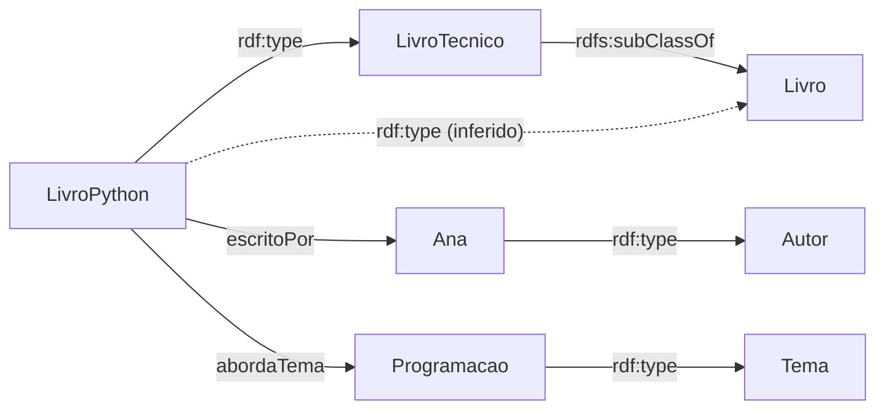

# Questão 1: Ontologias e Grafos de Conhecimento

## 1. Introdução

Uma ontologia define formalmente os conceitos de um domínio, suas propriedades e os axiomas que estabelecem relações e restrições entre eles. Em OWL 2, é possível representar hierarquias de classes e restrições sobre suas propriedades (W3C, 2012). Um grafo de conhecimento organiza entidades e fatos por meio de nós e relações. Neste exemplo, será utilizado RDF, que representa informações em triplas de sujeito, predicado e objeto (W3C, 2014a).

As duas abordagens não são mutuamente exclusivas. Uma ontologia pode fornecer o vocabulário e a semântica dos fatos de um grafo de conhecimento. Conforme o W3C (2012), a própria ontologia pode ser representada em RDF, o que permite reunir o esquema conceitual e os dados em uma mesma representação.

## 2. Comparação entre as abordagens

| Aspecto | Sistemas baseados em ontologias | Sistemas baseados em grafos de conhecimento |
| --- | --- | --- |
| Ênfase | Definição formal dos conceitos, propriedades e axiomas do domínio. | Representação e conexão de entidades e fatos do domínio. |
| No catálogo | Define o significado de Livro, Autor e Tema e suas relações. | Registra que LivroPython foi escrito por Ana e aborda Programacao. |
| Organização | Classes, hierarquias e propriedades com semântica definida. | Nós e relações; em RDF, conjuntos de triplas. |
| Raciocínio | Os axiomas permitem estabelecer consequências lógicas, conforme a linguagem utilizada. | Os fatos podem ser consultados e ampliados com inferências quando associados a uma semântica apropriada. |
| Hipótese de mundo | Em OWL, vale a hipótese de mundo aberto: a ausência de um fato não implica sua negação. | Em bancos de grafos, consultas costumam operar sob mundo fechado: o que não está armazenado é tratado como inexistente. |
| Esquema | Exige modelagem conceitual prévia, com classes e axiomas definidos antes dos dados. | O esquema pode evoluir de forma incremental, à medida que novos tipos de entidades e relações são incorporados. |
| Linguagens e ferramentas | OWL 2, editores como Protégé e reasoners como HermiT e Pellet. | RDF com SPARQL ou grafos de propriedades com Cypher, em sistemas como Neo4j. |
| Escala e uso típico | Domínios especializados com vocabulário controlado, como Gene Ontology e SNOMED CT. | Grandes coleções de fatos interligados, como Wikidata e o Google Knowledge Graph. |
| Complementaridade | Oferece uma estrutura conceitual compartilhada para os dados. | Representa os fatos usando essa estrutura, podendo incluir também o esquema. |

A diferença está na ênfase de cada abordagem. Uma ontologia também pode conter indivíduos, e um grafo pode conter definições de classes e propriedades (W3C, 2012). A distinção entre esquema e fatos ajuda a explicar o exemplo, mas não exige separar as tecnologias.

## 3. Exemplo de aplicação: catálogo de livros

Considere um catálogo que poderia apoiar recomendações por assunto ou autoria. A ontologia possui as classes Livro, LivroTecnico, Autor e Tema. LivroTecnico é subclasse de Livro. A propriedade escritoPor relaciona livros a autores, enquanto abordaTema relaciona livros a temas.

No catálogo fictício, LivroPython é um LivroTecnico, Ana é uma instância de Autor e Programacao é uma instância de Tema. O catálogo registra que LivroPython foi escrito por Ana e aborda Programacao. Uma consulta por livros sobre programação poderia recuperar esse item. Esses dados apoiariam uma recomendação, mas não definem, sozinhos, preferências de usuários ou critérios de ordenação.

## 4. Mapeamento da ontologia para o grafo

O mapeamento usa identificadores para classes, propriedades e indivíduos. Conforme o W3C (2014b), rdfs:subClassOf expressa a hierarquia entre classes, e rdf:type indica a classe à qual um indivíduo pertence. As propriedades do catálogo representam as relações de autoria e assunto. As triplas RDF são escritas em Turtle, uma sintaxe textual definida pelo W3C (2014c).

```turtle
@prefix ex:   <https://example.org/catalogo/> .
@prefix rdf:  <http://www.w3.org/1999/02/22-rdf-syntax-ns#> .
@prefix rdfs: <http://www.w3.org/2000/01/rdf-schema#> .
@prefix owl:  <http://www.w3.org/2002/07/owl#> .

# Esquema: classes, hierarquia e propriedades
ex:Livro rdf:type owl:Class .
ex:LivroTecnico rdf:type owl:Class .
ex:Autor rdf:type owl:Class .
ex:Tema rdf:type owl:Class .

ex:LivroTecnico rdfs:subClassOf ex:Livro .

ex:escritoPor rdf:type owl:ObjectProperty ;
    rdfs:domain ex:Livro ;
    rdfs:range ex:Autor .

ex:abordaTema rdf:type owl:ObjectProperty ;
    rdfs:domain ex:Livro ;
    rdfs:range ex:Tema .

# Dados: indivíduos e fatos explicitamente representados
ex:LivroPython rdf:type ex:LivroTecnico .
ex:Ana rdf:type ex:Autor .
ex:Programacao rdf:type ex:Tema .

ex:LivroPython ex:escritoPor ex:Ana .
ex:LivroPython ex:abordaTema ex:Programacao .
```

O prefixo ex: usa um endereço ilustrativo. Em Turtle, cada instrução terminada em ponto pode representar uma ou mais triplas; o ponto e vírgula mantém o sujeito e introduz outro predicado (W3C, 2014c).

O esquema define o significado das relações usadas nos dados. Segundo o W3C (2014b), domínio e alcance permitem inferir os tipos dos sujeitos e objetos relacionados; não são validações que rejeitam automaticamente dados de tipos diferentes. O modelo não inclui restrições de cardinalidade ou disjunção.

O diagrama mostra parte das triplas, sem as declarações de classes e propriedades nem suas relações de domínio e alcance. As setas contínuas correspondem a fatos ou axiomas explícitos. A seta pontilhada representa a classificação inferida.



## 5. Inferência e conclusão

O bloco principal declara que LivroPython pertence à classe LivroTecnico e que LivroTecnico é subclasse de Livro. Pela semântica de rdfs:subClassOf, toda instância da subclasse também pertence à superclasse (W3C, 2014b). Dessas duas triplas, podemos inferir:

```turtle
@prefix ex:  <https://example.org/catalogo/> .
@prefix rdf: <http://www.w3.org/1999/02/22-rdf-syntax-ns#> .

# Conhecimento inferido, não declarado no bloco principal
ex:LivroPython rdf:type ex:Livro .
```

Essa classificação também pode ser inferida a partir dos domínios de escritoPor e abordaTema (W3C, 2014b), mas a demonstração acima usa apenas o tipo declarado e a hierarquia. A inferência foi apresentada como dedução lógica, sem executar um reasoner.

No catálogo, uma consulta que considere essa inferência pode recuperar livros técnicos ao buscar instâncias de Livro, mesmo sem a declaração manual desse tipo para cada item. A hierarquia da ontologia permite, assim, consultar o catálogo em um nível mais geral.

## 6. Referências utilizadas

W3C (2014a). RDF 1.1 Concepts and Abstract Syntax. Recomendação, 25 fev. 2014. Disponível em: [https://www.w3.org/TR/rdf11-concepts/](https://www.w3.org/TR/rdf11-concepts/).

W3C (2014b). RDF Schema 1.1. Recomendação, 25 fev. 2014. Disponível em: [https://www.w3.org/TR/rdf-schema/](https://www.w3.org/TR/rdf-schema/).

W3C (2012). OWL 2 Web Ontology Language Primer (Second Edition). Recomendação, 11 dez. 2012. Disponível em: [https://www.w3.org/TR/owl2-primer/](https://www.w3.org/TR/owl2-primer/).

W3C (2014c). RDF 1.1 Turtle: Terse RDF Triple Language. Recomendação, 25 fev. 2014. Disponível em: [https://www.w3.org/TR/turtle/](https://www.w3.org/TR/turtle/).
