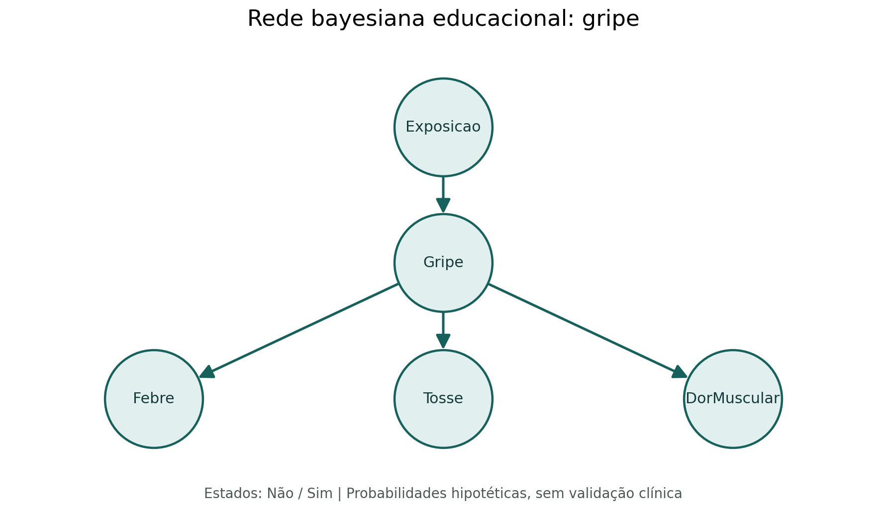

# Questão 8: Sistema de diagnóstico médico com redes bayesianas

Lista 2 de Inteligência Artificial, 2026.2. Professor Evandro Costa.

## 1. Introdução

O sistema estima a probabilidade de gripe em um modelo educacional a partir de exposição recente e sintomas observados. A rede bayesiana representa as dependências por um grafo direcionado acíclico e associa uma distribuição de probabilidade a cada variável. Assim, é possível atualizar a distribuição de gripe quando novas evidências são informadas, mantendo explícita a incerteza.

Todas as probabilidades foram fornecidas no enunciado como parâmetros hipotéticos. Os resultados demonstram inferência probabilística e não constituem diagnóstico médico nem estimativas clínicas validadas.

## 2. Domínio e variáveis

| Variável no código | Significado | Estados, nesta ordem |
|---|---|---|
| Exposicao | Exposição recente hipotética a uma fonte de infecção | Não, Sim |
| Gripe | Presença de gripe no modelo | Não, Sim |
| Febre | Presença de febre | Não, Sim |
| Tosse | Presença de tosse | Não, Sim |
| DorMuscular | Presença de dor muscular | Não, Sim |

Há cinco variáveis binárias, uma doença principal e três sintomas observáveis. A consulta tem Gripe como alvo e aceita as outras quatro variáveis como evidências. Uma variável não informada permanece desconhecida e é marginalizada, o que difere de observá-la no estado Não.

O modelo não distingue intensidade ou duração dos sintomas e não representa outras doenças. O estado Gripe=Não não significa ausência de qualquer doença. Sintomas podem ocorrer nesse estado, conforme as CPTs. Nenhum caso fictício da questão 7 foi utilizado para definir os parâmetros.

## 3. Estrutura da rede



As quatro arestas são Exposicao → Gripe, Gripe → Febre, Gripe → Tosse e Gripe → DorMuscular. A interpretação causal adotada é que a exposição influencia a ocorrência de gripe e a gripe influencia os sintomas. As arestas codificam hipóteses do modelo, não relações causais comprovadas por esta implementação.

Usando E, G, F, T e D para as cinco variáveis, a distribuição conjunta é:

```text
P(E,G,F,T,D) = P(E) P(G|E) P(F|G) P(T|G) P(D|G).
```

Os sintomas são mutuamente independentes quando o estado de gripe é conhecido. Por exemplo, P(F,T|G)=P(F|G)P(T|G). Cada sintoma também é independente da exposição dado Gripe. Sem condicionar em Gripe, os sintomas geralmente são dependentes, pois compartilham uma causa no grafo. A implementação verifica a d-separação dos três pares de sintomas dado Gripe e a conexão desses pares sem esse condicionamento.

Essa independência condicional simplifica a representação e reduz o número de parâmetros. Na prática, sintomas podem compartilhar mecanismos e fatores não representados, mesmo quando o estado de gripe é conhecido.

## 4. Tabelas de probabilidades

As CPTs usam explicitamente a ordem Não, Sim nas linhas e nos estados dos pais. Cada coluna soma 1. A escolha dos valores torna a exposição favorável à gripe e os sintomas mais prováveis na presença da doença, sem tornar nenhuma relação determinística. São escolhas plausíveis apenas para a demonstração, sem origem em estudos médicos.

### Exposição recente

| Exposicao | P(Exposicao) |
|---|---:|
| Não | 0,80 |
| Sim | 0,20 |

### Gripe condicionada à exposição

| Gripe | Exposicao=Não | Exposicao=Sim |
|---|---:|---:|
| Não | 0,95 | 0,70 |
| Sim | 0,05 | 0,30 |

### Febre condicionada à gripe

| Febre | Gripe=Não | Gripe=Sim |
|---|---:|---:|
| Não | 0,85 | 0,15 |
| Sim | 0,15 | 0,85 |

### Tosse condicionada à gripe

| Tosse | Gripe=Não | Gripe=Sim |
|---|---:|---:|
| Não | 0,65 | 0,20 |
| Sim | 0,35 | 0,80 |

### Dor muscular condicionada à gripe

| DorMuscular | Gripe=Não | Gripe=Sim |
|---|---:|---:|
| Não | 0,80 | 0,25 |
| Sim | 0,20 | 0,75 |

## 5. Inferência probabilística

O código utiliza DiscreteBayesianNetwork e TabularCPD para representar o modelo e VariableElimination para fazer inferência exata. A eliminação de variáveis combina fatores, incorpora as evidências, soma sobre as variáveis não consultadas e normaliza o resultado. Não foi implementado um motor próprio de inferência. A consulta retorna os dois estados de Gripe, sem reduzir o resultado a uma classificação.

Sem evidências, a própria rede calculou P(Gripe=Sim)=0,10 e P(Gripe=Não)=0,90. A conferência independente usa a probabilidade total:

```text
P(G=Sim) = P(E=Sim)P(G=Sim|E=Sim) + P(E=Não)P(G=Sim|E=Não)
         = 0,20 × 0,30 + 0,80 × 0,05 = 0,10.
```

Para febre presente, a conferência pelo teorema de Bayes é:

```text
P(F=Sim) = 0,85 × 0,10 + 0,15 × 0,90 = 0,22.
P(G=Sim|F=Sim) = (0,85 × 0,10) / 0,22
              = 0,3863636364 ≈ 38,636364%.
```

O resultado coincide com o pgmpy. A atualização ocorre porque febre é mais provável com gripe (0,85) do que sem gripe (0,15). Isso aumenta a probabilidade da doença, mas não a torna certa.

## 6. Experimentos e resultados

Os resultados abaixo foram obtidos executando `python rede_bayesiana.py --demo`. Os percentuais foram arredondados para seis casas decimais. Em todos os cenários, a referência sem evidências é a distribuição Não=90% e Sim=10%.

### Experimentos 1 e 2: febre e inclusão progressiva de sintomas

| Etapa | Evidências acumuladas | P(Gripe=Não) | P(Gripe=Sim) |
|---|---|---:|---:|
| A priori | Nenhuma | 90,000000% | 10,000000% |
| 1 e 2.1 | Febre=Sim | 61,363636% | 38,636364% |
| 2.2 | Febre=Sim, Tosse=Sim | 40,997831% | 59,002169% |
| 2.3 | Febre=Sim, Tosse=Sim, DorMuscular=Sim | 15,632754% | 84,367246% |

O experimento 1 é também a primeira etapa do experimento 2. Em cada etapa, a consulta considera todas as evidências acumuladas na mesma rede. A distribuição anterior à segunda etapa é a obtida apenas com febre; antes da terceira, é a obtida com febre e tosse. O código não modifica as CPTs nem reutiliza a posterior como uma nova CPT, o que contaria evidências novamente.

Os três sintomas presentes favorecem gripe neste modelo. Seus fatores de verossimilhança para presença de gripe são 0,85/0,15 para febre, 0,80/0,35 para tosse e 0,75/0,20 para dor muscular. Sob a independência condicional assumida, essas contribuições se combinam e a probabilidade chega a 84,367246%. Ainda existe probabilidade de ausência de gripe.

### Experimento 3: evidências negativas

| Evidências | P(Gripe=Não) | P(Gripe=Sim) |
|---|---:|---:|
| Febre=Não, Tosse=Não, DorMuscular=Não | 99,811818% | 0,188182% |

Esse experimento parte da distribuição sem evidências. A ausência dos sintomas é mais provável sem gripe, reduzindo a probabilidade de 10% para 0,188182%. O resultado fica abaixo dos cenários com sintomas presentes. Evidência negativa também informa a inferência, mas não elimina totalmente a possibilidade da doença. Não observar um sintoma é diferente de informar sua ausência.

### Experimento adicional: influência da exposição

| Evidências | P(Gripe=Não) | P(Gripe=Sim) |
|---|---:|---:|
| Exposicao=Sim | 70,000000% | 30,000000% |
| Exposicao=Não | 95,000000% | 5,000000% |
| Exposicao=Sim e três sintomas=Sim | 4,583723% | 95,416277% |
| Exposicao=Não e três sintomas=Sim | 28,118393% | 71,881607% |

Observar apenas exposição recupera as probabilidades condicionais de gripe da CPT. Com os três sintomas presentes, informar exposição aumenta o resultado de 84,367246% para 95,416277%; informar ausência de exposição reduz para 71,881607%. A ausência de exposição recente não impede gripe, pois P(Gripe=Sim|Exposicao=Não)=0,05.

### Verificações executadas

A demo foi executada com Python 3.13.12, pgmpy 1.1.2, NetworkX 3.7, Matplotlib 3.10.8 e NumPy 2.5.4. Ela confirmou:

1. Exatamente cinco variáveis e quatro arestas, com os três sintomas previstos.
2. Cinco CPTs, estados na ordem especificada, valores entre 0 e 1 e colunas normalizadas.
3. Validação pelo método `check_model()` do pgmpy.
4. A priori de 10%, equivalência com Bayes no caso de febre e resultados de referência dos experimentos obrigatórios, com tolerância absoluta de 10⁻¹² nas comparações dos experimentos.
5. Normalização e valores válidos nas 81 combinações de evidências: cada uma das quatro variáveis observáveis pode não ser informada, valer Não ou valer Sim.
6. Exportação e reimportação BIF com preservação de variáveis, arestas, ordem dos estados, eixos e valores das CPTs; equivalência das distribuições nas mesmas 81 consultas.
7. Rejeição de dez entradas inválidas, incluindo variável desconhecida, estado inválido, Gripe como evidência, formatos incorretos, repetições e contradições.
8. Independências condicionais dos sintomas por d-separação. O grafo usado para desenhar a imagem é comparado com os nós e as arestas do modelo.

Também foram conferidos os percentuais do relatório e da apresentação contra as nove consultas executadas. A estrutura do HTML tem cinco slides e recursos locais; a lógica de navegação foi executada em Node.js com um DOM simulado, incluindo botões, setas, Home, End e fragmentos de URL. O diagrama foi inspecionado como imagem. A revisão visual dos slides em um navegador não pôde ser concluída: a conexão de abas estava indisponível e o acesso à janela expirou aguardando aprovação. Portanto, o teste da navegação não substitui uma inspeção visual no navegador.

Essas verificações avaliam consistência e reprodução computacional. Não avaliam validade clínica ou acurácia diagnóstica. O pgmpy emitiu um FutureWarning interno sobre StructureScore, recurso não utilizado pelo sistema; a demo concluiu normalmente. O ambiente temporário usado nos testes foi removido após a validação; para executar novamente, é necessário instalar as dependências de `requirements.txt` em um ambiente Python.

## 7. Discussão e limitações

A rede mantém a incerteza explícita. Uma regra determinística, como “se há febre, então há gripe”, não expressaria os 61,363636% de probabilidade de ausência de gripe após observar febre neste modelo. A distribuição completa permite comparar cenários e incorporar evidências adicionais sem exigir uma decisão binária imediata.

Os resultados dependem diretamente das CPTs. Probabilidades hipotéticas diferentes produziriam outras posteriores, mesmo com o mesmo grafo e os mesmos sintomas. Não foi feita uma análise numérica de sensibilidade variando parâmetros. A simplificação de independência condicional pode atribuir peso excessivo a sintomas que, na realidade, permaneçam relacionados por fatores omitidos.

O domínio binário não contempla gravidade, tempo de evolução, incerteza na observação, exames ou diagnósticos alternativos. O modelo não foi treinado com dados, não foi comparado com casos clínicos e não possui validação clínica. Portanto, os valores calculados não devem orientar decisões médicas.

Possíveis melhorias incluem estimar CPTs com dados confiáveis e representativos, avaliar calibração e sensibilidade e revisar as dependências com especialistas. Fatores adicionais e outras doenças poderiam ser incluídos em uma versão futura, com validação adequada. Esta versão mantém exclusivamente as cinco variáveis exigidas.

## 8. Execução e demonstração

Os arquivos do projeto são `rede_bayesiana.py`, `requirements.txt`, `modelo.bif`, `rede.png`, `resposta.md` e `apresentacao.html`. O BIF contém a estrutura e as CPTs em um formato reimportável; não é necessário um projeto em ferramenta gráfica proprietária.

A partir de `questao_08/`, em um ambiente Python com as dependências instaladas:

```bash
python -m pip install -r requirements.txt
python rede_bayesiana.py --demo
python rede_bayesiana.py
python rede_bayesiana.py --evidencias "Febre=Sim,Tosse=Sim"
python rede_bayesiana.py --evidencias "Febre=Não,Tosse=Não,DorMuscular=Não"
python rede_bayesiana.py --evidencias "Exposicao=Sim,Febre=Sim,Tosse=Sim,DorMuscular=Sim"
```

Sem opções, o programa apresenta a priori. Com `--evidencias`, apresenta a priori e a posterior completa. Os nomes e estados diferenciam maiúsculas e minúsculas, e Não deve incluir o acento. Espaços ao redor dos nomes e estados são removidos. `--demo` e `--evidencias` são opções mutuamente exclusivas. Entradas como `Febre=Sim,Febre=Não` são rejeitadas com mensagem de erro e código de saída 2.

A demo regenera `modelo.bif` em UTF-8 e `rede.png` na pasta do script, independentemente do diretório de execução. Para importar preservando o acento dos estados em qualquer sistema operacional:

```python
from pathlib import Path
from pgmpy.readwrite import BIFReader

modelo = BIFReader(string=Path("modelo.bif").read_text(encoding="utf-8")).get_model()
assert modelo.check_model()
```

A apresentação `apresentacao.html` abre diretamente no navegador, sem internet. Tem cinco slides, navegáveis pelos botões, setas do teclado, Home e End. Para demonstrar, apresente a estrutura e as CPTs, execute a demo no terminal, compare as distribuições e retome as limitações no último slide. Não foi produzido vídeo ou PDF consolidado.

## 9. Referências

As referências fundamentam os conceitos e a utilização da biblioteca; nenhuma delas é fonte das probabilidades hipotéticas do exercício.

1. ANKAN, Ankur; TEXTOR, Johannes. [pgmpy: A Python Toolkit for Bayesian Networks](https://jmlr.org/papers/v25/23-0487.html). Journal of Machine Learning Research, v. 25, n. 265, p. 1-8, 2024.
2. PGMPY. [DiscreteBayesianNetwork](https://pgmpy.org/api/generated/models/pgmpy.models.DiscreteBayesianNetwork.html). Documentação oficial: estrutura, distribuições e validação de redes discretas.
3. PGMPY. [VariableElimination](https://pgmpy.org/api/generated/inference/pgmpy.inference.VariableElimination.html). Documentação oficial: consulta com evidências e inferência exata.
4. PGMPY. [Código-fonte de BIFReader e BIFWriter](https://pgmpy.org/_modules/pgmpy/readwrite/BIF.html). Documentação oficial: representação e leitura das CPTs em BIF.
